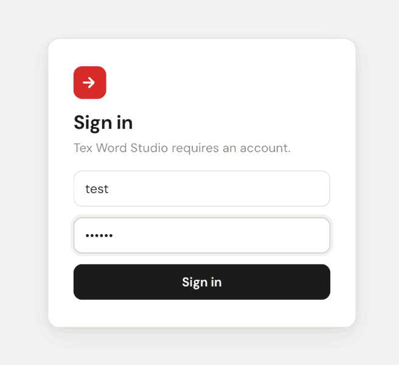
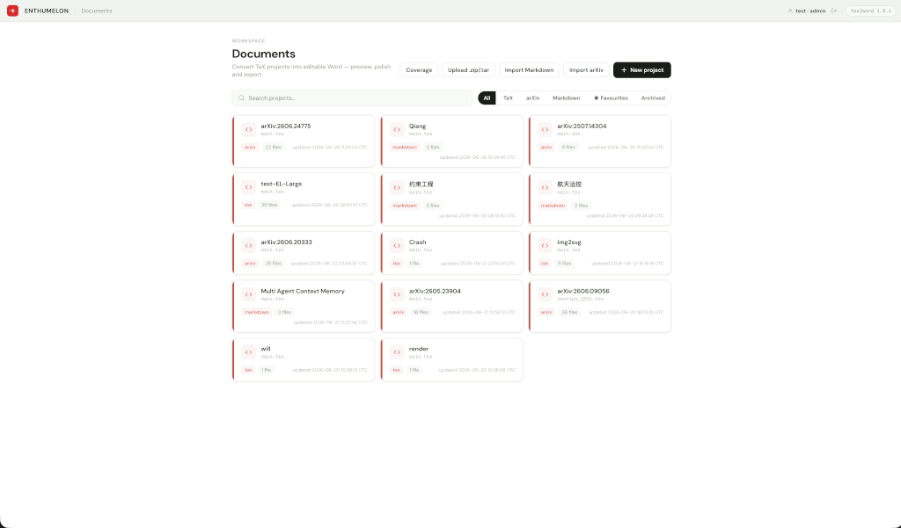
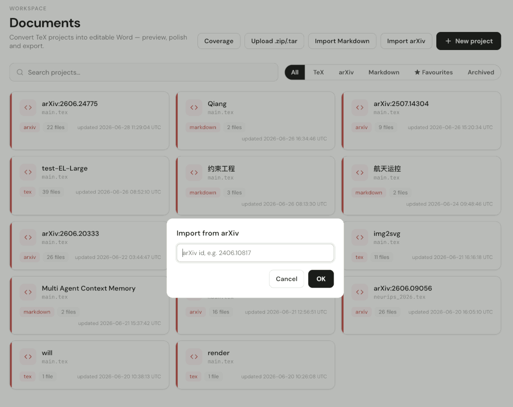
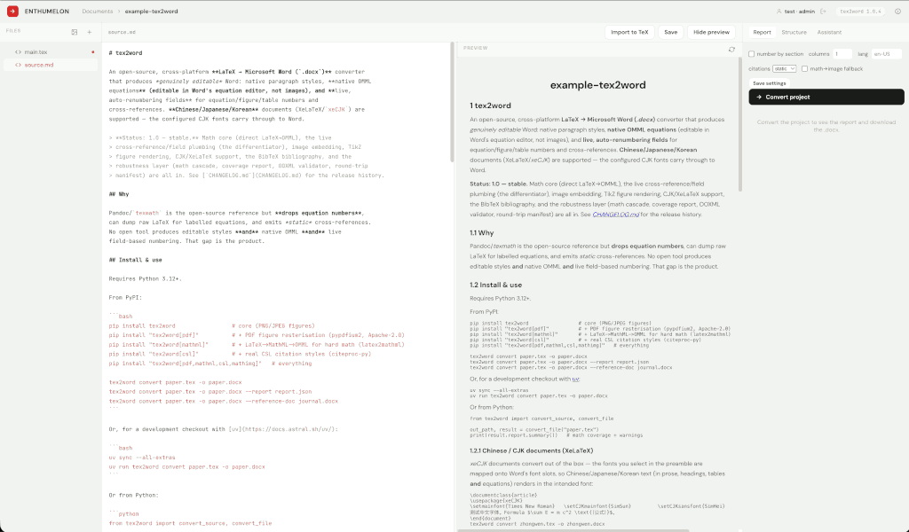
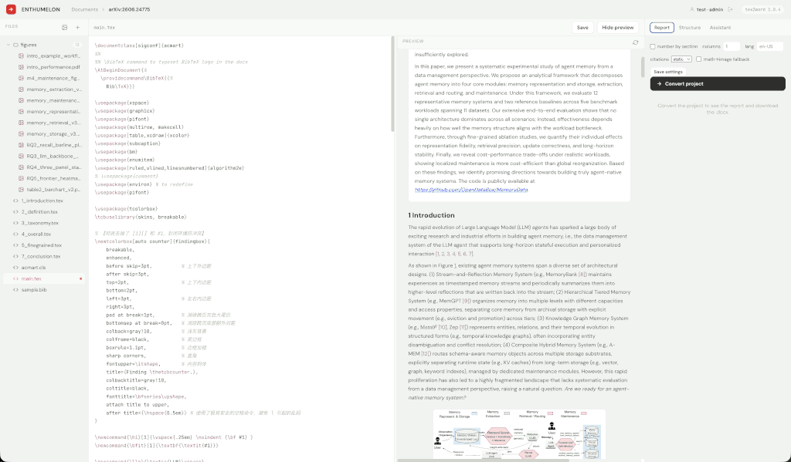
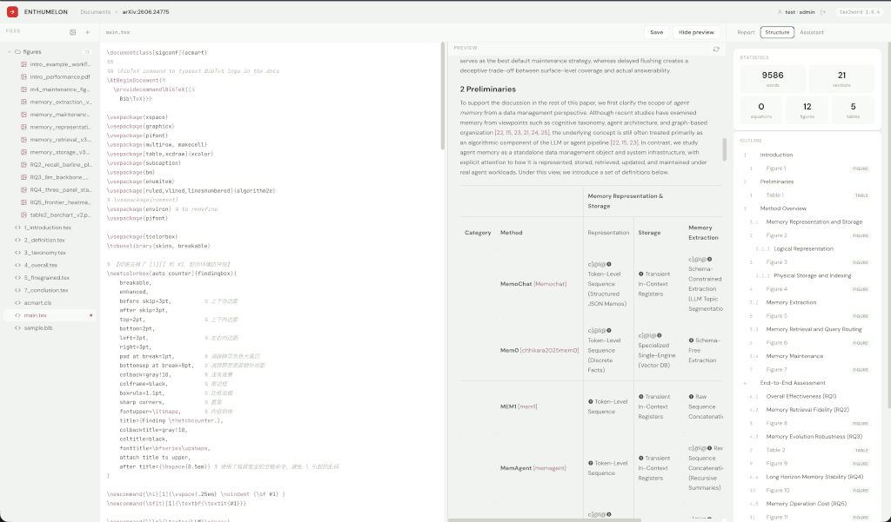
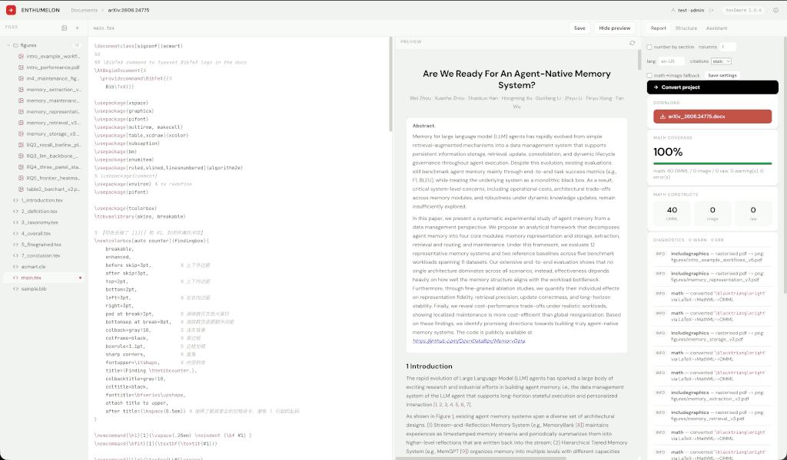
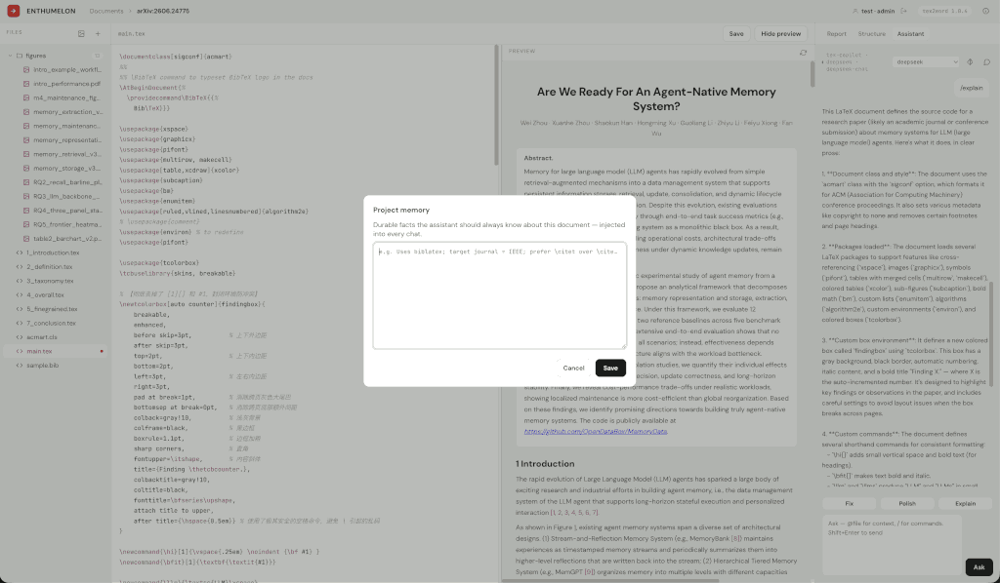

# Tex Word Studio

A web workspace for converting **LaTeX → Microsoft Word (`.docx`)** with the
[`tex2word`](https://pypi.org/project/tex2word/) engine. tex2word is the
essential module; the web app is a thin adapter around its IR and outputs.


| Image | Description |
|:------|:------------|
| [](./assets/01-login.png) | Project login page |
| [](./assets/02-project.png) | Project overview/dashboard |
| [](./assets/03-import-arXiv.png) | Import from arXiv interface |
| [](./assets/04-import-markdown.png) | Import markdown files interface |
| [](./assets/05-main.png) | Main application interface, sync location for single file |
| [](./assets/06-main-structure.png) | Main document structure/organization view |
| [](./assets/07-convert-log.png) | tex2word convert log interface |
| [](./assets/08-chat-memory.png) | Chat memory/conversation history |


## Features

- **Convert** LaTeX (single file or multi-file project) to a real `.docx`, with a
  conversion **report** (math coverage, diagnostics) and download. Conversions
  run as **background jobs** (poll for status) and output is stored **durably**
  (SQLite), surviving restarts.
- **Projects** persisted in SQLite — a **collapsible folder tree** (add / rename /
  delete files in place), multi-file `\input`/`\include` resolution, with **syntax
  highlighting** for LaTeX and Markdown in the editor. The gallery supports
  **search**, **kind/state filters**, and per-card **favourite / archive / rename
  / delete**.
- **Figures** — upload images (or import them in an archive); `\includegraphics`
  embeds real figures in the `.docx` and shows them in the preview. **PDF/EPS**
  graphics and inline **TikZ/PGF** are rasterised for the preview via tex2word's
  own backend (install the `pdf` extra; TikZ also needs a TeX engine on `PATH`).
- **Live preview** of the rendered document with typeset math (native MathML),
  a structure **outline** and **statistics** — in a resizable source⇄preview split
  with **two-way sync across files**: click the editor to follow in the preview,
  click the preview to open the file it came from at that line, even through
  `\input`/`\include`. Editing a chapter keeps the whole document in the preview.
- **Quick / Full preview** — *Quick* re-parses only the blocks you edited and
  swaps just those in the page (typically 50–150 ms on a full paper); it falls
  back to a full render, and says why, whenever a local update could be wrong,
  and reconciles with a full render once you pause. *Full* re-renders everything
  on every change. Both skip building a `.docx`, so even full renders are ~2×
  faster than before.
- **Smart autocompletion** in the editor — commands (math-aware), environments
  with block snippets and tabstops, `\ref` → labels (with what they label),
  `\cite` → bibliography keys (author · year · title), project macros (with
  their definition and optional arguments), colours with swatches, suggested
  `\label` names, `\input`/`\includegraphics` paths and packages; Enter after
  `\begin{env}` adds the `\end`. Unknown `\ref`/`\cite` keys are underlined.
- **Tab completion** — Tab completes a unique match, opens the list when several
  match, walks snippet stops, expands an environment name typed alone on a line,
  and indents otherwise (Shift+Tab outdents; Esc then Tab leaves the editor).
- **Symbol palette** — ~250 common symbols with SVG glyph previews (also shown
  in the completion list), searchable by name or group; math symbols are
  wrapped in `$…$` when inserted outside math.
- **Table generator** (left panel → Tools) — build a LaTeX table in a
  spreadsheet-like grid: paste cells from Excel/Sheets, CSV or LaTeX, merge cells,
  bold/italic/underline, alignment, borders, text and cell colours; pick standard
  or booktabs style, caption, landscape, width (tabularx / scaled), long table.
  The code updates live and is inserted at the cursor — or replaces the table the
  cursor was in — with any missing `\usepackage` lines added to the preamble.
- **TikZ editor** (left panel → Tools) — draw and edit TikZ figures visually with
  [TikZ Editor](https://github.com/DominikPeters/tikz-editor) by Dominik Peters
  (MIT), embedded in a dialog: canvas tools, drag-to-move, inspector, live code.
  It opens on the `tikzpicture` at the cursor (or a new one) with the preamble's
  `\tikzset` styles, colours and libraries loaded, and writes the picture back —
  adding any new libraries or definitions to the preamble. The editor bundle is
  built once with `scripts/build_tikz_editor.sh` (the Docker image does it).
- **File outline** (left panel) — the open file's sections, figures, tables,
  equations, theorems and `\input` files; click to jump (or open the file), and
  the item you are in stays highlighted.
- **Editor chrome** — line numbers that follow wrapped lines, a current-line
  highlight, and a status bar (line/column, selection, lines, words, file role);
  **Ctrl/Cmd+S** saves. File-type icons and a `MAIN` badge in the file tree.
- **Dark theme** — follows the system, or pin Light/Dark from the top bar;
  **?** lists the keyboard shortcuts.
- **Collapsible, resizable side panels** — hide the files pane (**Ctrl/Cmd+B**)
  or the report/assistant pane (**Ctrl/Cmd+Alt+B**), drag their edges to resize;
  the layout is remembered per browser, and narrow windows fold the panels
  without changing it.
- **tex-copilot assistant** — an **agent** that works on the project: it lists,
  reads and searches files, outlines them, runs a tex2word **check**, and
  proposes **edits** that you review per file (diff, apply / reject, conflict
  detection) before anything is saved. **Chat** mode answers without tools.
  Replies **stream** with Stop, render as safe Markdown (copy / insert code
  blocks), and can be regenerated or edited & resent. Context chips carry the
  open file, the selection and `@file` mentions; `/`-skills run templates.
  Chats persist per project, with a rolling summary and per-project memory.
- **Providers & models in the app** — add or edit OpenAI-compatible and
  Anthropic providers (presets for OpenAI, Anthropic, DeepSeek, OpenRouter, Kimi,
  Ollama, vLLM), their **model lists** (e.g. `deepseek-flash`, `deepseek-pro`;
  fetch from `/models`) and default model, and **test the connection**. API keys
  are **write-only** and **encrypted at rest** (AES-256-GCM; master key from
  `TEX2WORD_SECRET_KEY` or a `0600` key file), or read from an env var.
- **Skills & prompts** — create / edit / delete custom skills (agent or chat,
  with `{file}` / `{selection}` / `{input}` placeholders; built-ins can be
  duplicated) and saved prompts, plus standing instructions and the agent's step
  limit. With `[auth]` on, this configuration is admin-only.
- **Import** from **Markdown** (→ LaTeX → Word), an **arXiv** source bundle, or
  an uploaded **`.zip`/`.tar(.gz)`** archive of a LaTeX project.
- **Coverage dashboard** — aggregate tex2word metrics (math OMML coverage,
  warnings/errors, `.docx` validity) across all projects.
- **Round-trip** a tex2word-generated `.docx` back to LaTeX.
- **Optional accounts** — turn on `[auth]` for a login gate with scrypt-hashed
  passwords and RSA-signed (RS256) JWT sessions; manage users and the database
  with the `manage.py` admin CLI. Off by default (the app stays open). With auth
  on, projects (and their chats/jobs) are **scoped to their owner**.
- **Hardened** — per-IP **rate limiting** (tighter on login / convert / LLM) and
  a request **body-size cap**, both configurable in `[security]`.

The UI follows the **Enthumelon** design system.

## Requirements

- Python **≥ 3.12** (`tex2word` requires it)
- [`uv`](https://docs.astral.sh/uv/)

## Quickstart

```bash
# create the env and install (app + dev deps)
uv venv --python 3.12
uv pip install -e ".[dev]"

# run the app (dev, auto-reload)
uv run uvicorn app.main:app --reload
# open http://127.0.0.1:8000

# optional: build the embedded TikZ editor (needs git + Node.js ≥ 20; ~1–2 min)
scripts/build_tikz_editor.sh

# run the tests
uv run pytest                     # Python suite
node --test tests/js/*.test.js    # frontend unit tests (sync + autocomplete engines)
NODE_PATH=$(npm root -g) node tests/e2e/run.js   # browser end-to-end (Playwright + Chromium)
```

### Managing the server

`server.sh` runs the app in the background with a PID file and log
(`server.log`). Host/port come from `config.toml` `[backend]`; override with
`TEX2WORD_HOST` / `TEX2WORD_PORT`.

```bash
./server.sh --start     # start in the background
./server.sh --status    # running? on which host:port
./server.sh --restart   # stop then start
./server.sh --stop      # stop
```

## Configuration

Runtime settings live in `config.toml` (TOML). Copy the sample and edit:

```bash
cp config.sample.toml config.toml   # config.toml is gitignored
```

It defines the backend host/port, CORS origins, and the LLM providers used by
the **tex-copilot assistant** (`POST /api/assistant` — fix / polish / explain /
ask over the current file and conversion report). The `default.provider` selects
which provider the assistant uses; `claude`-type providers go through the
Anthropic SDK (default model `claude-opus-4-8`), `openai`-type providers through
the OpenAI SDK against their `base_url` (DeepSeek, Kimi, Minimax, vLLM, …).
Provider API keys are read from environment variables via `api_key_env`
(preferred) or given inline with `api_key`. A provider may list `models = [...]`
for the model picker. Providers can also be added and edited **in the app**
(Assistant → settings); a provider edited there overrides the config one field
by field, and keys entered there are encrypted with the master key from
`TEX2WORD_SECRET_KEY` (32 bytes, url-safe base64) or the key file at
`[security] secret_key_path` (created with mode 0600 on first use — back it up,
or stored keys can't be decrypted). The app loads `config.toml` if
present and falls back to `config.sample.toml` otherwise. `GET /api/config`
returns a **redacted** view — key values are never exposed, only `has_key` and
the env-var name. With no key set, the assistant returns a clear `422`.

Imports are bounded by `[import]`: `max_archive_mb` (default **100**) caps an
arXiv download or uploaded archive *and* the total size of the files extracted
from it, and `max_archive_files` (default 500) caps the file count. Over the
limit, the import fails with a `413` naming the setting to raise. Archive
uploads may exceed `[security].max_body_mb` up to `max_archive_mb`.

## Accounts & admin (optional auth)

Authentication is **off by default** — the app runs open. To require a login,
use the `manage.py` admin CLI and enable `[auth]`:

```bash
uv run python manage.py init-keys                       # write the RSA keypair (0600)
uv run python manage.py create-admin --username you      # prompts for a password
# then set `enabled = true` under [auth] in config.toml and restart
```

Passwords are hashed with **scrypt** (memory-hard, salted — never stored or
recoverable in plaintext). Sessions are **JWTs signed with an RSA private key**
(RS256) and verified with the public key; the SPA shows a login gate and sends
the token on every request (`?access_token=` is accepted for ``/downloads).

`manage.py` also manages the store: `list-users`, `passwd`, `set-role`,
`delete-user`, plus `db-info` (project/file/user counts + size) and `db-vacuum`.
It manages **assistant skills** too — `add-skill --name summarize --prompt
"…{source}…"`, `list-skills`, `delete-skill` — which then appear in the `/`
autocomplete for everyone. Run `uv run python manage.py --help` for everything.
The DB path follows `TEX2WORD_DB` / `[backend].metasqlite_db`; key paths come
from `[auth]`.

## API

| Method | Path | Body | Returns |
| --- | --- | --- | --- |
| `GET`  | `/api/health` | — | `{status, tex2word_version}` |
| `GET`  | `/api/config` | — | redacted config (providers, backend, CORS) |
| `POST` | `/api/convert` | `{source, filename?, options?}` | `{artifact_id, filename, download_url, report}` |
| `POST` | `/api/preview` | `{source, options?}` | `{html, outline, statistics, report, title}` |
| `POST` | `/api/assistant` | `{action, source, instruction?, report?, provider?, context?}` | `{reply, provider, model, action, is_code}` |
| `POST` | `/api/assistant/stream` | same as `/api/assistant` | `text/event-stream` (JSON deltas + a `done` event) |
| `GET`/`POST` | `/api/skills` | — / `{name, title, prompt, description?, mode?}` | built-in + custom skills / create |
| `PATCH`/`DELETE` | `/api/skills/{name}` | `{title?, prompt?, description?, mode?}` / — | edit / delete a custom skill |
| `GET`/`POST` | `/api/prompts` | — / `{title, body, description?}` | saved prompts / create |
| `PATCH`/`DELETE` | `/api/prompts/{pid}` | `{title?, body?, description?}` / — | edit / delete a prompt |
| `GET`/`POST` | `/api/providers` | — / `{name, type, api_base, models, default_model, api_key?, api_key_env?, tools, enabled}` | providers (keys never returned) / create |
| `PATCH`/`DELETE` | `/api/providers/{name}` | same fields / — | edit / delete (or reset a config provider) |
| `POST` | `/api/providers/{name}/test` | `{model?}` | `{ok, reply or error, model, ms}` |
| `GET`  | `/api/providers/{name}/remote-models` | — | `{models}` from the provider's `/models` |
| `PUT`  | `/api/assistant/defaults` | `{provider, model?}` | default provider + model |
| `GET`/`PUT` | `/api/assistant/settings` | — / `{instructions?, max_steps?, default_mode?}` | assistant behaviour |
| `POST` | `/api/conversations/{cid}/agent` | `{content, mode?, skill?, provider?, model?, active_file?, selection?, files?}` | `text/event-stream` agent turn (steps, text, changes), persisted |
| `POST` | `/api/conversations/{cid}/messages/{mid}/changes` | `{action: apply\|reject, paths?}` | `{changes, written}` |
| `POST` | `/api/conversations/{cid}/truncate` | `{message_id}` | drops that message and everything after |
| `POST`/`GET` | `/api/projects/{id}/conversations` | `{title?}` / — | chat session(s) |
| `GET`/`PATCH`/`DELETE` | `/api/conversations/{cid}` | — / `{title}` / — | a conversation + messages |
| `POST` | `/api/conversations/{cid}/message[/stream]` | `{content, source?, skill?, provider?, context?}` | reply (JSON or SSE), persisted |
| `GET`/`PUT` | `/api/projects/{id}/memory` | — / `{memory}` | per-project assistant memory |
| `GET`  | `/api/coverage` | — | `{aggregate, rows}` metrics across all projects |
| `GET`  | `/api/coverage.html` | — | tex2word's native coverage dashboard (HTML) |
| `GET`  | `/api/artifacts/{id}` | — | the `.docx` (attachment) |
| `POST` | `/api/to-latex` | multipart `file=<docx>` | `{latex}` |
| `POST` | `/api/markdown/to-tex` | `{markdown, title?}` | `{latex}` (Markdown → LaTeX) |
| `POST` | `/api/auth/login` | `{username, password}` | `{token, user}` (when auth enabled) |
| `GET`  | `/api/auth/me` | — (bearer token) | `{username, role}` |
| `GET`  | `/` | — | the single-page workspace |

The **preview** renders the tex2word IR to HTML (math as native MathML via
`latex2mathml`), with a document outline and statistics. tex2word stays the
source of truth — citations, cross-references and structure come from the
engine; the web layer only assigns the display numbers Word would. In the
workspace, source and preview sit in a **resizable split** (drag the divider) and
the preview can be hidden; it refreshes on demand and shortly after you stop
typing.

### Projects (multi-file)

Projects persist to SQLite (`config.toml` `[backend].metasqlite_db`, override
with `TEX2WORD_DB`). Converting a project resolves `\input`/`\include` across
its files. When a project has several files with `\documentclass`, the file you
**click** in the tree becomes the render/convert root (`main_path` override); if
none is selected, the detected main (the `\begin{document}` file) is used.

| Method | Path | Body | Returns |
| --- | --- | --- | --- |
| `POST`   | `/api/projects` | `{name, kind?, main_path?, files?}` | project detail (201) |
| `GET`    | `/api/projects` | — | `[project summary]` |
| `GET`    | `/api/projects/{id}` | — | project detail (files) |
| `PATCH`  | `/api/projects/{id}` | `{name?, main_path?, favourite?, archived?}` | project detail |
| `DELETE` | `/api/projects/{id}` | — | 204 |
| `PUT`    | `/api/projects/{id}/settings` | `{settings}` | project detail (persisted options) |
| `PUT`    | `/api/projects/{id}/files/{path}` | `{content}` | file (text) |
| `POST`   | `/api/projects/{id}/assets/{path}` | multipart `file` | file (binary) |
| `POST`   | `/api/projects/{id}/convert/async` | `{options?, filename?, main_path?}` | `{job_id, status, status_url}` (202) |
| `GET`    | `/api/jobs/{job_id}` | — | `{status, …, download_url, report}` when done |
| `GET`    | `/api/projects/{id}/files/{path}/raw` | — | the raw file bytes |
| `DELETE` | `/api/projects/{id}/files/{path}` | — | 204 |
| `POST`   | `/api/projects/{id}/convert` | `{options?, filename?, main_path?}` | `{artifact_id, filename, download_url, report}` |
| `POST`   | `/api/projects/{id}/preview` | `{options?, main_path?, mode?, base_rev?}` | `{html, segments, outline, statistics, report, title, mode, reason, rev, main_path, source_map, timings, chunks}` |
| `POST`   | `/api/projects/import/markdown` | `{name, markdown}` | project detail (201) |
| `POST`   | `/api/projects/import/arxiv` | `{arxiv_id}` | project detail (201) |
| `POST`   | `/api/projects/import/archive` | multipart `file=<zip/tar>`, `name?` | project detail (201) |

**Live preview:** `mode` is `"full"` (default) or `"quick"` (re-parse only the
changed chunks; the reply's `mode`/`reason` say if it had to run as full).
`segments` is `[[key, html], …]`, one keyed top-level element each; when the
request's `base_rev` is the server's last `rev`, segments the client already has
come back with `html: null` (and `html` itself is `null`). Elements carry
`data-src="fileIndex:line"` sync anchors indexing `source_map.files`;
`source_map.includes` lists `[file, line, target]` for every `\input`. A
`main_path` that is a fragment resolves to the file that includes it.

**Import:** Markdown is converted to a LaTeX document (mistune AST → LaTeX) and
still converted to Word by tex2word; the original `.md` is kept. arXiv pulls the
paper's LaTeX **source** bundle and turns its text files into a project. Archive
upload accepts a `.zip` or `.tar(.gz)`: its text files (`.tex/.bib/.sty/…`) become
the project (a shared top-level folder is stripped; binaries are skipped).

`options`: `number_by_section` (bool), `columns` (1–4), `language` (BCP-47
string), `frontend` (`pure` | `latexml`), `citation_mode` (`static` | `zotero`),
`csl` (a project-relative `.csl` style path), `math_image_fallback` (bool),
`reference_doc` (a project-relative template `.docx`). Projects also persist
these as defaults via `PUT /api/projects/{id}/settings`.

Example:

```bash
curl -s localhost:8000/api/convert \
  -H 'content-type: application/json' \
  -d '{"source":"\\documentclass{article}\\begin{document}Hi $E=mc^2$.\\end{document}"}'
```

## Project layout

```
app/
  main.py        FastAPI routes + static mount + error mapping
  service.py     tex2word boundary (convert / preview / to-latex / report)
  preview.py     IR → HTML preview (keyed segments) + outline + statistics
  sourcemap.py   flatten \input with line origins + invisible sync markers
  livepreview.py full / incremental ("quick") preview engine with fallbacks
  projects.py    project + file CRUD (over SQLite)
  db.py          SQLite connection + schema
  store.py       durable artifact store for converted .docx (SQLite)
  jobs.py        async conversion jobs (JobStore + thread-pool JobQueue)
  config.py      config.toml loader (backend, CORS, LLM providers)
  llm.py         LLM layer: streaming + tool calls (Anthropic / OpenAI-compatible)
  assistant.py   tex-copilot prompts (fix / polish / explain / ask)
  assistant_api.py  assistant routes: providers, settings, skills, prompts, agent turns
  agent.py       the agent loop + project tools over a staged workspace
  providers.py   provider registry (config + in-app overrides, presets)
  secretbox.py   AES-256-GCM encryption for stored API keys
  prompts.py     saved prompts store
  ingest.py      Markdown → LaTeX (mistune) + arXiv fetch/unpack
  auth.py        scrypt passwords + RSA-signed (RS256) JWT sessions
  security.py    per-IP rate limiter (body-size cap + authz live in main.py)
  users.py       user accounts store (over SQLite)
  skills.py      assistant skill registry (built-ins + custom)
  chat.py        persisted multi-turn conversations + messages
  models.py      pydantic schemas
  static/        single-page UI (HTML/CSS/JS + design tokens); sync.js and
                 complete.js are DOM-free engines shared with the node tests;
                 symbols.js + symbols.svg are the symbol list and its sprite;
                 tablegen.js (engine) + tablegen-ui.js the table generator;
                 tikzedit.js + tikzedit-ui.js the TikZ editor dialog;
                 icons.js (file types) + outline.js (file outline) engines,
                 ux.js the editor gutter/status bar/outline/theme/shortcuts,
                 theme.js the early theme switch,
                 markdown.js (safe Markdown) + assistant-ui.js the assistant
  static/vendor/tikz-editor/  built TikZ editor bundle (not committed)
  tikzeditor.py  TikZ editor bundle detection + the CSP its pages get
tests/           pytest suite (one file per area) + conftest
  js/            node unit tests for the frontend engines
  e2e/           Playwright end-to-end specs + runner (boots the app on a temp DB)
manage.py        admin / DB management CLI (users, keys, db-info)
scripts/build_symbols.py  regenerate app/static/symbols.svg from symbols.js
scripts/build_favicon.py  regenerate app/static/favicon.ico (the brand mark)
scripts/build_tikz_editor.sh  build the embedded TikZ editor (pinned upstream commit)
tools/tikz-editor-embed/  embed shell + host bridge + patches for that build
config.sample.toml  configuration template (copy to config.toml)
DEVELOPER-MANUAL.md  architecture & internals
server.sh        start/stop/status/restart wrapper
```

See [`DEVELOPER-MANUAL.md`](DEVELOPER-MANUAL.md) for the architecture, module
guide, testing, and extension recipes.


# Author

Yifan Yang <yfyang.86 AT hotmail>

Lic: Apache 2.0
